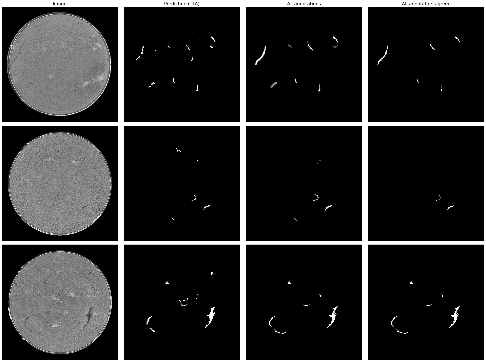

# CompassNet: Orientation-Aware Network for Solar Filament Segmentation



This repository contains a solution submitted to the [Solar Filament Segmentation Challenge 2026](https://kaggle.com/competitions/filament-segmentation-2026), a Kaggle competition organized by the Earth-Space AI Research (ESAIR) Lab. The challenge consists of the automatic segmentation of solar filaments in GONG H-alpha observations and uses the MAGFiLO dataset.

The submitted model is CompassNet. **The repository includes the source code, trained weights, a notebook containing the entire pipeline, and a list of required packages.** For installation, you can either use `requirements.txt` or the Pixi environment defined in `pixi.toml`.

The pipeline is also publicly available on Kaggle: [Orientation-Aware Net for Filament Segmentation](https://www.kaggle.com/code/hermengardo/orientation-aware-net-for-filament-segmentation)

The final weights are stored in `models/cnet@2048x567.pt`.

## Directory Tree

```
.
├── training.ipynb            # the whole pipeline
├── self-evaluation-notebook.ipynb  # evaluation notebook, used for the validation results
├── submission.csv            # Final Predictions
├── models/
│   ├── cnet@2048x567.pt      # final weights, used for the submission (reads model@ResolutionxSeed.pt)
│   ├── DistilSSL.pt          # backbone pretrained with distillation (LightlyTrain)
│   └── MaskedSSL.pt          # backbone pretrained with masked image completion
├── src/
│   ├── CompassNet.py         # the model architecture
│   ├── Config.py             # configuration parameters and directory paths
│   ├── Loss.py               # loss functions (segmentation and spine)
│   ├── Pretraining.py        # self-supervised pretraining (masked image completion)
│   ├── PretrainingLightlyTrain.py # self-supervised pretraining via distillation (LightlyTrain)
│   ├── SunDataset.py         # dataset and soft-target masking
│   ├── training.py           # standalone script for training CompassNet
│   └── utils.py              # image processing and evaluation helper functions
├── data/
│   ├── SILSO.csv             # sunspot numbers, used for the solar cycle-stratified split
│   ├── images_table.csv      # metadata table of the GONG images used in pretraining
│   ├── ssl_post_prep.py      # preprocessing script for pretraining images
│   └── README.md             # detailed documentation of the dataset
├── latex/                    # LaTeX source code and assets for the technical report
├── history/                  # Train history of the final model and output log
├── report_compass.pdf        # compiled technical report of the solution
└── requirements.txt          # Python dependencies and exact package versions
```


